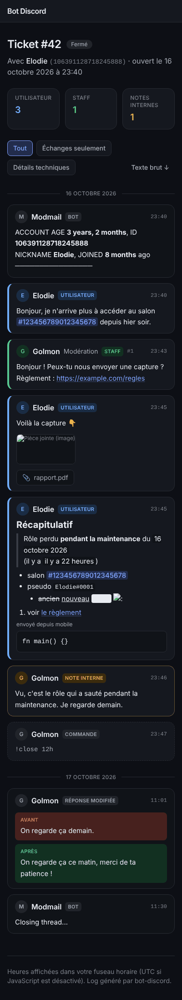

# Site web

Le bot sert un petit site sur le port **8890** : logs et recherche des tickets, statistiques du staff et des
serveurs. Il démarre toujours, même sans module ticket, ne serait-ce que pour `/healthz`.

| Page | Contenu | Accès |
|---|---|---|
| `/` | Accueil : liens vers les pages accessibles au compte connecté | Tout le monde |
| `/logs` | Liste et recherche des tickets | Staff des tickets |
| `/logs/<id>` | Log d'un ticket | Staff des tickets (ou lien seul, voir plus bas) |
| `/logs/staff` | Statistiques du staff sur 30 jours | Staff des tickets |
| `/stats/<serveur>` | Statistiques d'un serveur | `site.stats` (« Gérer le serveur » par défaut) |
| `/stats/<serveur>/cotisations` | [Cotisations](#cotisations) : totaux, classement, détail, export CSV | `cotisation.stats` (gradés par défaut) |
| `/stats/<serveur>/coffres` | [Coffres](#coffres) : stock, activité par joueur, mouvements, export CSV | `coffre.voir` (gradés par défaut) |
| `/stats/<serveur>/contacts` | [Contacts](#contacts) : répertoire filtrable, notes du staff | `contact.notes` (gradés par défaut) |
| `/stats/<serveur>/journal` | [Journal du staff](modules.md#journal-du-staff) | `site.journal` (« Gérer le serveur » par défaut) |
| `/stats/<serveur>/transactions` | Historique des transactions, export CSV | `transaction.historique` (« Gérer le serveur » par défaut) |
| `/healthz` | Répond `ok` (health check de la plateforme) | Tout le monde |

Le **staff des tickets** est défini par l'option `inboxServerPermission` sur le serveur inbox
([options](tickets-options.md)), comme pour les commandes `!r`, `!close`…

Les pages d'un serveur suivent les niveaux réglés sur Discord avec `/config permission`
([Permissions](modules.md#permissions)) : ouvrir `coffre.voir` aux membres du groupe leur ouvre aussi la
page des coffres.

## Mise en place

### 1. Adresse publique en HTTPS

Le bot parle HTTP simple ; le HTTPS est assuré devant lui.

**Northflank** : dans le service → **Ports & DNS → Add port** : port `8890`, protocole **HTTP**, case
**Publicly expose** cochée. Northflank attribue une adresse `https://….code.run` avec un certificat valide.

**Domaine personnalisé** (ex. `bot.mon-domaine.fr`) : **Team settings → Domains → Add domain**, créer chez
le registraire l'enregistrement de vérification, puis ajouter le sous-domaine, créer le `CNAME` indiqué et
le lier au port `8890` du service. Le certificat Let's Encrypt est généré automatiquement.

**Ailleurs** : un reverse proxy devant le port 8890, par exemple Caddy (certificat automatique) :

```
bot.mon-domaine.fr {
    reverse_proxy localhost:8890
}
```

Mettre ensuite l'adresse dans **`WEB_URL`**, sans `/` final : `WEB_URL=https://bot.mon-domaine.fr`. Avec le
module ticket, `MM_URL` prend la même valeur (c'est elle qui sert dans les liens de logs envoyés sur Discord).

### 2. Connexion Discord

1. [Portail développeur Discord](https://discord.com/developers/applications) → l'application → **OAuth2**.
2. **Client Secret → Reset Secret** : copier la valeur dans la variable **`DISCORD_CLIENT_SECRET`** (à
   ranger dans un *Secret group* sur Northflank, jamais dans le dépôt).
3. **Redirects → Add Redirect** : l'adresse du site suivie de `/auth/callback`, par exemple
   `https://bot.mon-domaine.fr/auth/callback`. **Save Changes**.
4. Redéployer, ouvrir l'adresse du site : bouton **Se connecter**.

Discord demande seulement l'autorisation *identify* (pseudo et avatar) : le site ne lit ni les serveurs ni
les messages du compte.

## Pages

### Tickets


Recherche par pseudo, identifiant Discord, numéro de ticket (`42` ou `#42`) ou texte d'un message (messages
de l'utilisateur, réponses et notes internes), filtre par statut. La colonne 🙋 indique qui a pris le
ticket en charge (bouton *Prendre en charge* sur Discord).

### Log d'un ticket

 

- Messages de l'utilisateur, réponses du staff (numéro, rôle affiché, anonymat), notes internes, commandes,
  réponses modifiées (avant / après) et supprimées.
- Markdown Discord complet : titres, sous-texte, citations, listes, gras/italique/souligné/barré, spoilers
  (clic pour révéler), code, liens masqués, émojis personnalisés, mentions affichées avec les vrais noms.
- Images en aperçu, fichiers en lien, embeds résumés.
- Heures et horodatages Discord (`<t:…>`, y compris le style relatif « il y a 3 jours ») affichés dans le
  fuseau horaire du lecteur.
- Filtres **Échanges seulement** (sans notes internes, commandes ni messages du bot) et **Détails techniques** (identifiants des
  messages), et **Texte brut** : le log au format exact de modmailbot.
- Thème clair ou sombre selon le système, adapté au mobile.

### Statistiques


- **Serveur** (`/stats/<id>`) : présences clôturées, taux de présence moyen et assiduité de chaque membre
  (présent / retard / absent), absences en cours, recrues de la semaine avec leurs avis et vétos,
  transactions en cours, véhicules. Le bloc tickets s'affiche sur le serveur principal du module ticket.
- **Staff** (`/logs/staff`) : sur 30 jours, tickets ouverts, créés, fermés et sans réponse, délai médian de
  première réponse ; par membre du staff : réponses, tickets, prises en charge, premières réponses et délai
  moyen.

### Transactions


Lien **Historique des transactions** depuis l'accueil et la page de statistiques du serveur
(`/stats/<id>/transactions`).

- **Filtres** : groupe (recherche partielle, sans tenir compte des majuscules), statut, achat ou vente,
  période **du / au** (jours en heure de Paris, bornes incluses). Les filtres restent dans l'adresse : une
  vue filtrée peut être mise en favori ou partagée avec quelqu'un qui a le même accès.
- **Totaux** de la sélection : nombre de transactions, total des achats et des ventes, solde (ventes −
  achats), transactions en cours. Les transactions **annulées** comptent dans le nombre, pas dans les
  montants.
- **Par mois** : achats, ventes, solde et nombre, du plus récent au plus ancien (12 derniers mois de la
  sélection).
- **Détail** : 25 transactions par page, des plus récentes aux plus anciennes ; un clic sur une ligne
  affiche ses objets (quantité, prix unitaire).
- **Exporter en CSV** reprend les filtres en cours (10 000 lignes au plus) : séparateur `;`, encodage UTF-8
  reconnu par Excel, dates `JJ/MM/AAAA HH:MM` en heure de Paris, prix en nombre (virgule décimale). Une
  cellule qui commence par `=`, `+`, `-` ou `@` est préfixée d'une apostrophe pour qu'Excel ne l'exécute
  pas comme une formule.

### Cotisations


Périodes 7 jours, 30 jours, 90 jours, 1 an ou tout ; totaux en argent propre, sale et au total ;
classement des membres avec leur part ; clic sur un membre pour ne voir que ses cotisations ; détail des
cotisations (avec qui les a déclarées pour un autre) ; export CSV pour Excel. `/cotisations` mène
directement au serveur de la personne connectée.

### Coffres


Stock de chaque propriété, activité par personnage (déposé, retiré, membre relié), liste des mouvements
filtrable par propriété, objet, type, joueur et période (24 h, 7, 30, 90 jours ou tout ; 30 jours par défaut),
export CSV.

### Contacts


Le répertoire des contacts ([module Contacts](modules.md#contacts)) : nombre d'alliés, de neutres et
d'hostiles ; filtres par relation, par type et recherche dans le nom ou la description. Un clic sur un
contact déplie sa description et toutes les **notes du staff**, des plus récentes aux plus anciennes.
`/contacts` mène directement au serveur de la personne connectée.

## Sécurité

- La session est un cookie signé (HMAC-SHA256, clé dérivée du token du bot), `HttpOnly`, `SameSite=Lax`,
  `Secure` en HTTPS, valable **7 jours**. Régénérer le token du bot déconnecte tout le monde.
- Les droits sont recalculés à **chaque page** : retirer un rôle ou une permission coupe l'accès
  immédiatement, sans attendre l'expiration de la session.
- En-têtes stricts : CSP sans script externe, pas d'intégration dans une autre page, pas d'indexation par
  les moteurs de recherche.

**Sans `DISCORD_CLIENT_SECRET`**, la connexion est désactivée : les logs restent lisibles par leur lien
(identifiant non devinable, comme dans modmailbot) et les autres pages affichent « Connexion non
configurée ». Déconseillé en production : n'importe qui ayant reçu un lien de log peut le lire.
