# Site web

Le bot sert sur le port **8890** une interface React (dossier [`ui/`](../ui/README.md)) et l'API JSON qu'elle
utilise (`/api`, [spécification OpenAPI](#api)). Il démarre toujours, même sans module ticket, ne serait-ce que
pour `/healthz`. Thème clair ou sombre (selon le système ou au choix), adapté au mobile.

| Page | Contenu | Accès |
|---|---|---|
| `/` | Accueil : pages ouvertes au compte connecté, par serveur | Tout le monde |
| `/serveurs/<serveur>` | [Statistiques](#statistiques) du serveur | `site.stats` (« Gérer le serveur » par défaut) |
| `/serveurs/<serveur>/transactions` | [Transactions](#transactions) : historique, graphique mensuel, export CSV | `transaction.historique` (« Gérer le serveur » par défaut) |
| `/serveurs/<serveur>/cotisations` | [Cotisations](#cotisations) : totaux, graphique, objectif, saisie, export CSV | `cotisation.stats` (gradés par défaut) |
| `/serveurs/<serveur>/coffres` | [Coffres](#coffres) : stock, évolution d'un objet, mouvements, export CSV | `coffre.voir` (gradés par défaut) |
| `/serveurs/<serveur>/contacts` | [Contacts](#contacts) : répertoire, notes du staff, saisie | `contact.voir` (notes : `contact.notes`) |
| `/serveurs/<serveur>/presences` | [Présences](#présences) : liste, détail, assiduité, plannings, création | `presence.stats` (créer : `presence.creer`, plannings : `presence.gerer`) |
| `/serveurs/<serveur>/absences` | [Absences](#absences) : frise, liste, déclaration | Membres du groupe (pour un autre : `absence.autrui`) |
| `/serveurs/<serveur>/recrues` | [Recrues](#recrues) : avis de la semaine, vétos, historique | `recrue.suivi`, `recrue.avis` ou `recrue.veto` (strictes) |
| `/serveurs/<serveur>/annuaire` | [Annuaire](#annuaire) : véhicules et numéros | `vehicule.utiliser` (véhicules), membres du groupe (numéros) |
| `/serveurs/<serveur>/membres/<id>` | [Fiche d'un membre](#fiche-dun-membre) | `membre.fiche` (gradés par défaut), ou soi-même |
| `/serveurs/<serveur>/journal` | [Journal du staff](modules.md#journal-du-staff) | `site.journal` (« Gérer le serveur » par défaut) |
| `/serveurs/<serveur>/permissions` | [Permissions](#permissions) de chaque action | « Gérer le serveur » |
| `/serveurs/<serveur>/configuration` | [État de la configuration](#configuration), objectif, alertes des coffres | « Gérer le serveur » |
| `/tickets`, `/tickets/staff` | Liste et recherche des tickets, statistiques du staff sur 30 jours | Staff des tickets |
| `/logs/<id>` | [Log d'un ticket](#log-dun-ticket) (`?raw=1` : texte brut au format modmailbot) | Staff des tickets (ou lien seul, voir plus bas) |
| `/healthz` | Répond `ok` (health check de la plateforme) | Tout le monde |

Les anciennes adresses (`/stats/<serveur>/…`, `/logs`, `/logs/staff`, `/cotisations`, `/contacts`) redirigent vers
les nouvelles, filtres compris : les favoris et les liens déjà envoyés sur Discord restent valables.

Le **staff des tickets** est défini par l'option `inboxServerPermission` sur le serveur inbox
([options](tickets-options.md)), comme pour les commandes `!r`, `!close`…

Les pages d'un serveur suivent les niveaux réglés sur Discord avec `/config permission`
([Permissions](modules.md#permissions)) : ouvrir `coffre.voir` aux membres du groupe leur ouvre aussi la
page des coffres.

## Mise en place

### 1. Adresse publique en HTTPS

Le bot parle HTTP simple ; le HTTPS est assuré devant lui.

**Northflank** : dans le service → **Ports & DNS → Add port** : port `8890`, protocole **HTTP**, case
**Publicly expose** cochée. Northflank attribue une adresse `https://….code.run` avec un certificat valide.

**Domaine personnalisé** (ex. `bot.mon-domaine.fr`) : **Team settings → Domains → Add domain**, créer chez
le registraire l'enregistrement de vérification, puis ajouter le sous-domaine, créer le `CNAME` indiqué et
le lier au port `8890` du service. Le certificat Let's Encrypt est généré automatiquement.

**Ailleurs** : un reverse proxy devant le port 8890, par exemple Caddy (certificat automatique) :

```
bot.mon-domaine.fr {
    reverse_proxy localhost:8890
}
```

Mettre ensuite l'adresse dans **`WEB_URL`**, sans `/` final : `WEB_URL=https://bot.mon-domaine.fr`. Avec le
module ticket, `MM_URL` prend la même valeur (c'est elle qui sert dans les liens de logs envoyés sur Discord).

### 2. Connexion Discord

1. [Portail développeur Discord](https://discord.com/developers/applications) → l'application → **OAuth2**.
2. **Client Secret → Reset Secret** : copier la valeur dans la variable **`DISCORD_CLIENT_SECRET`** (à
   ranger dans un *Secret group* sur Northflank, jamais dans le dépôt).
3. **Redirects → Add Redirect** : l'adresse du site suivie de `/auth/callback`, par exemple
   `https://bot.mon-domaine.fr/auth/callback`. **Save Changes**.
4. Redéployer, ouvrir l'adresse du site : bouton **Se connecter**.

Discord demande seulement l'autorisation *identify* (pseudo et avatar) : le site ne lit ni les serveurs ni
les messages du compte.

## Pages

### Accueil et navigation

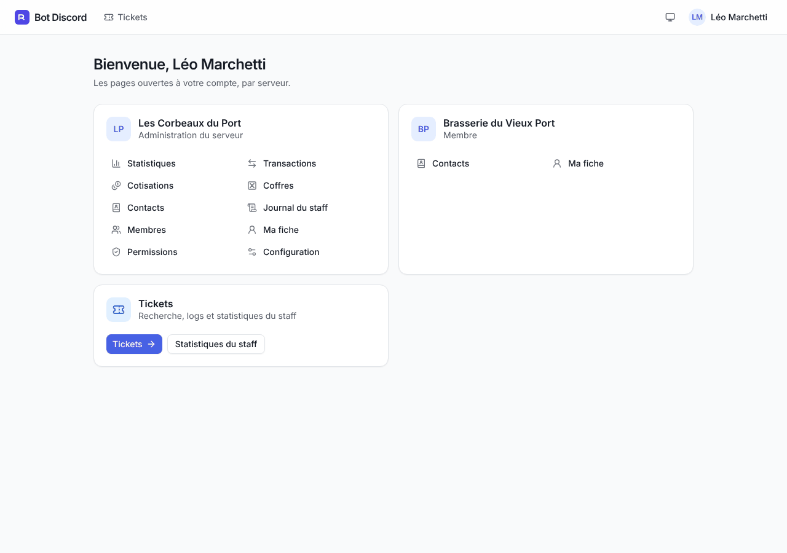 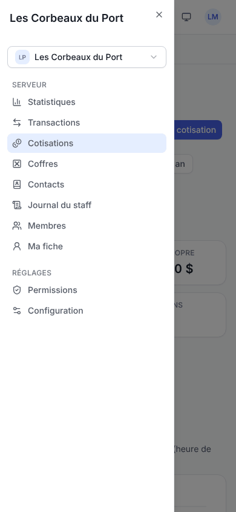

Une tuile par serveur avec les pages ouvertes au compte (le dernier serveur ouvert en premier, mémorisé par le
navigateur) ; dans un serveur, un menu latéral (tiroir sur mobile) et un sélecteur de serveur. Les graphiques
s'inspectent à la souris ou au clavier (flèches) et gardent un tableau des valeurs (« Afficher les données »). Une page sans le droit nécessaire affiche « Accès refusé ».

### Statistiques

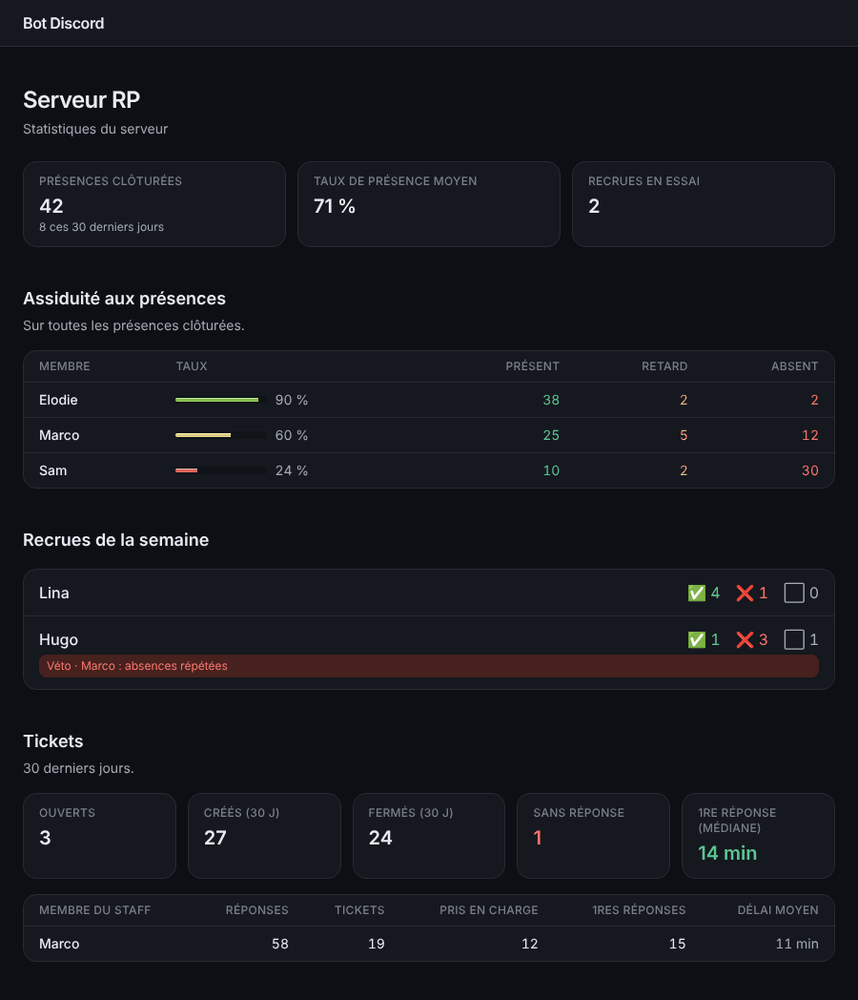 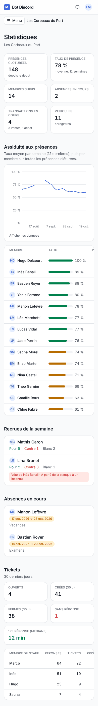

Présences clôturées, taux de présence moyen et **courbe de l'assiduité par semaine**, assiduité de chaque membre
(présent / retard / absent), absences en cours, recrues de la semaine avec leurs avis et vétos. Le bloc tickets
s'affiche sur le serveur principal du module ticket.

### Transactions

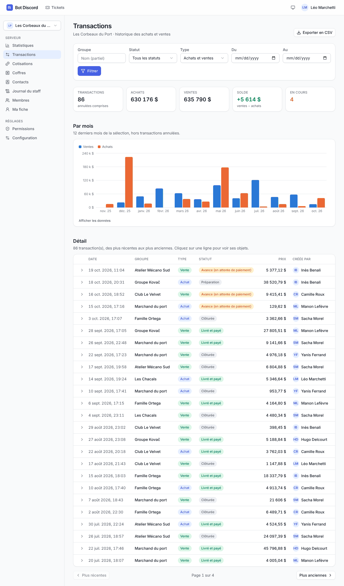

- **Filtres** dans l'adresse (favori ou partage possibles) : groupe, statut, achat ou vente, période du / au (jours
  en heure de Paris, bornes incluses).
- **Totaux** : nombre, achats, ventes, solde, en cours. Les transactions **annulées** comptent dans le nombre, pas
  dans les montants.
- **Graphique par mois** (achats et ventes), détail paginé avec les objets de chaque transaction.
- **Écriture** (`transaction.utiliser`) : **Nouvelle transaction** (groupe, achat ou vente, prix, objets) ; sous les
  objets d'une transaction dépliée, changer le statut, ajouter un objet, annuler. Comme `/transaction`, la fiche Discord
  et le tableau de bord sont mis à jour ; depuis le site, la fiche d'une nouvelle transaction est publiée dans le **salon
  du tableau de bord** (`/config transaction dashboard_channel`), sans lequel la création est refusée. Chaque écriture
  va au journal du staff ; une transaction clôturée n'est plus modifiable.
- **Export CSV** (10 000 lignes au plus) : séparateur `;`, UTF-8 reconnu par Excel, dates `JJ/MM/AAAA HH:MM`. Une
  cellule qui commence par `=`, `+`, `-` ou `@` est préfixée d'une apostrophe (pas de formule exécutée).

### Cotisations

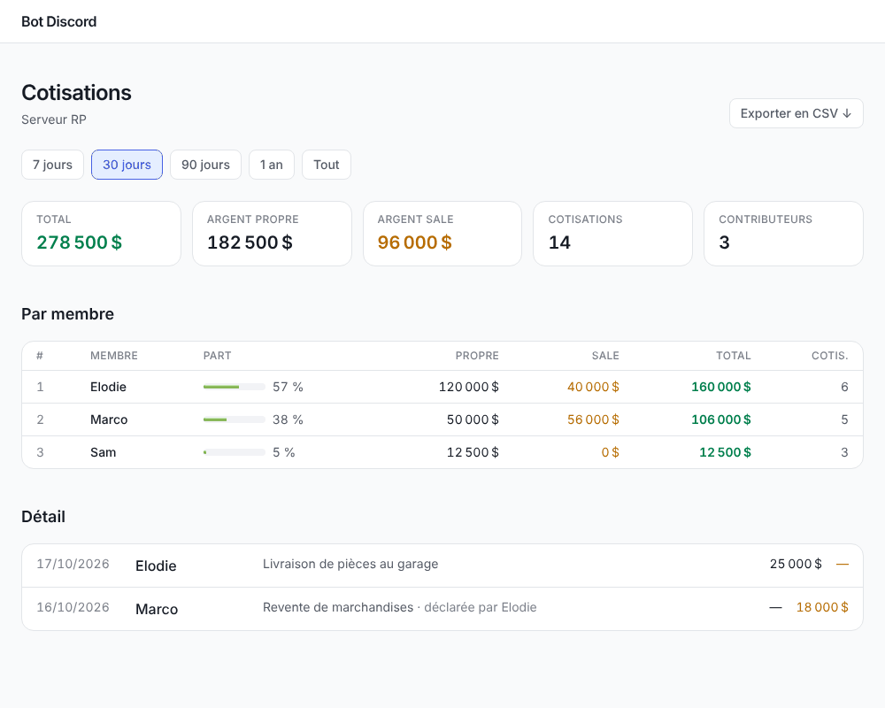 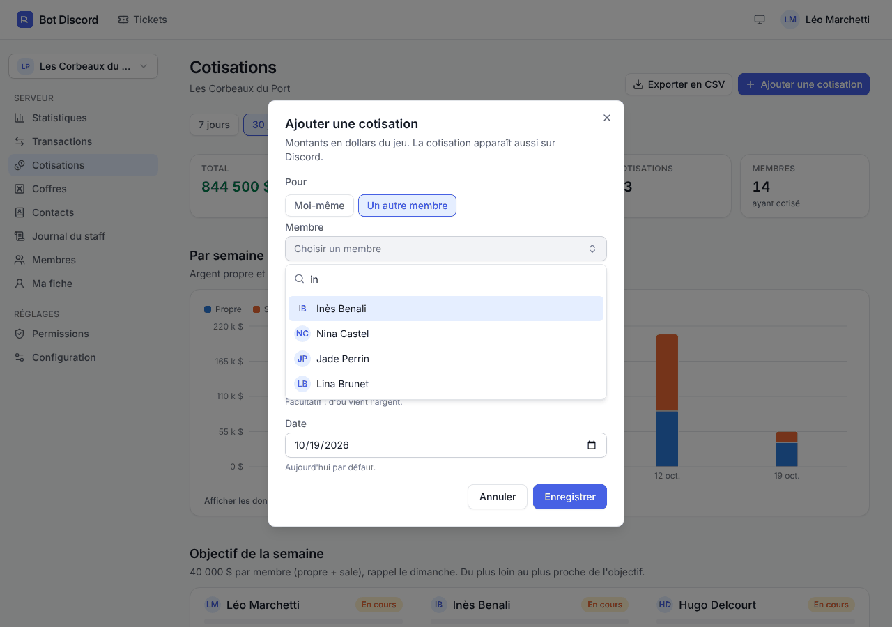

Périodes 7, 30, 90 jours, 1 an ou tout ; totaux propre / sale ; **graphique par semaine** ; classement avec la part
de chacun ; **objectif de la semaine** et avancement de chaque membre (absents et recrues exemptés) ; détail paginé.
Bouton **Ajouter une cotisation** (pour soi, ou pour un membre avec `cotisation.gerer`), suppression de ses
propres saisies, export CSV.

### Coffres

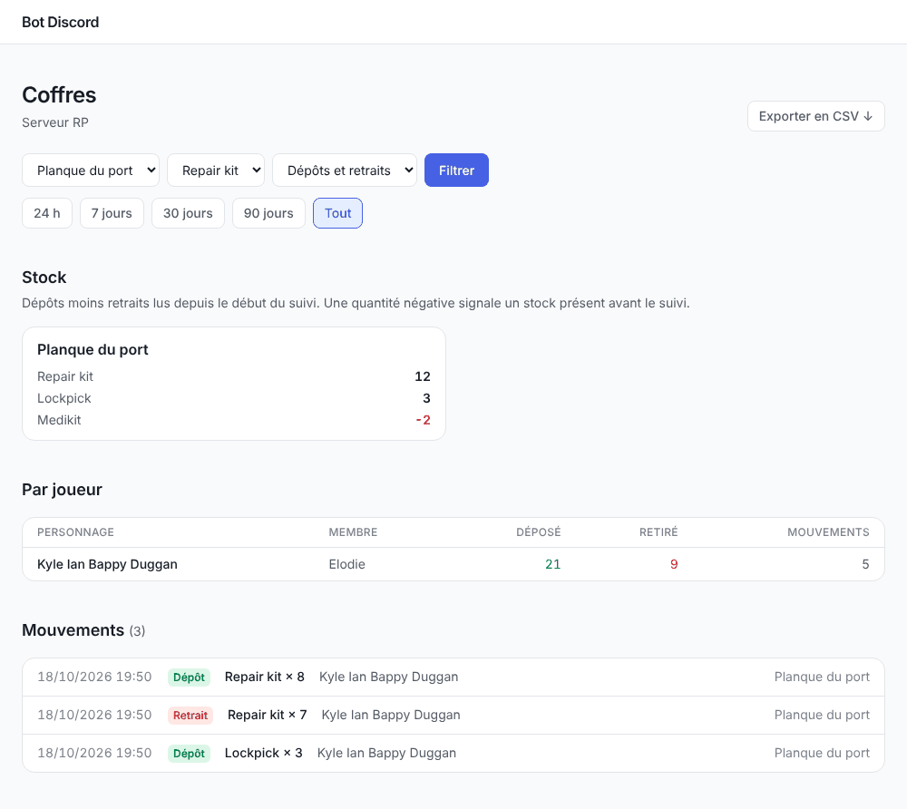

Stock de chaque propriété (objets **sous leur seuil** et stocks négatifs signalés), filtres propriété, objet, type,
joueur et période (30 jours par défaut), **évolution du stock** de l'objet choisi, activité par personnage, liste
des mouvements, export CSV. Avec `coffre.gerer` : nommer une propriété, relier ou délier un personnage.

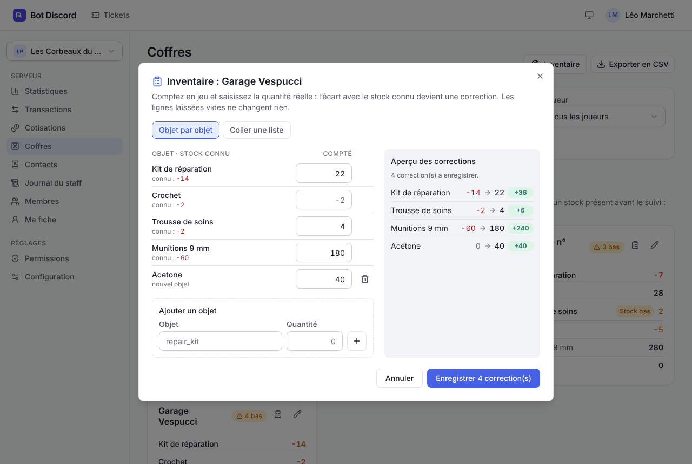

**Inventaire** (avec `coffre.gerer`, comme `/coffre inventaire`) : pour rattraper un stock antérieur au webhook ou
des objets entrés sans message du jeu, on compte en jeu et on saisit la quantité réelle, depuis le bouton de la
carte d'une propriété ou le bouton **Inventaire** de la page (propriété connue ou nouveau numéro). Chaque objet
connu montre son stock actuel ; une ligne laissée vide ne change rien. **Ajouter un objet** propose les objets
connus ou accepte un identifiant du jeu (`repair_kit`), et **Coller une liste** lit la même syntaxe que la commande
(`repair_kit:42, acetone 2790; x=1`). L'**aperçu des corrections** affiche avant l'envoi chaque écart (stock connu →
quantité comptée, +/−) ; seuls ces écarts partent et deviennent des mouvements **Correction** signés, avec leur
auteur. Les corrections apparaissent dans les mouvements (filtre « Corrections »), dans le stock (icône « dont +34
de corrections ») et dans l'évolution d'un objet (barres « Corrigé », courbe du stock comprise) ; elles ne comptent
pas dans l'activité des joueurs.

### Contacts

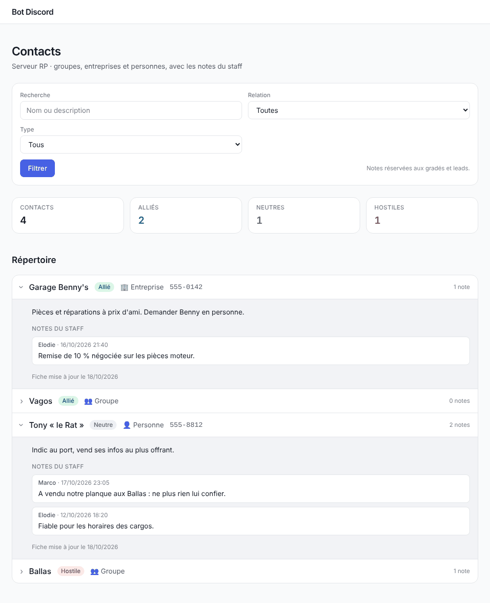 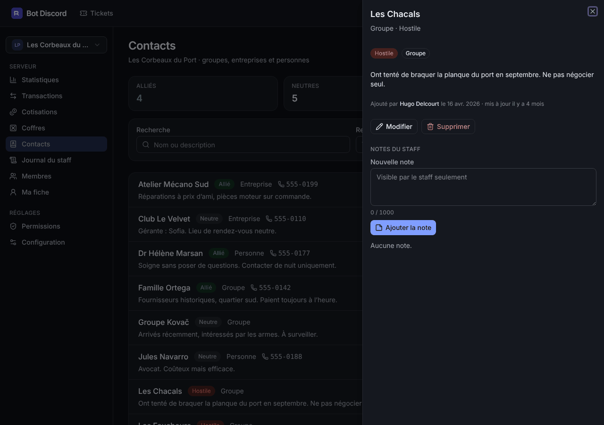

Nombre d'alliés, de neutres et d'hostiles, filtres par relation et par type, recherche. La fiche d'un contact
montre sa description et les **notes du staff** (`contact.notes`). Ajout, modification, suppression et notes depuis
le site, avec les mêmes effets que les commandes : répertoire publié sur Discord mis à jour, journal du staff.

### Présences

Trois vues : **Présences** (filtres état — à venir, ouvertes, closes — et période du / au, décompte ✅ ❌ ⏳ ❔ de
chacune), **Assiduité** et **Plannings** (avec `presence.gerer`). Un clic ouvre le détail : présents, retards (en
minutes), absents, sans réponse (membres actuels du rôle, comme le message Discord), changements d'avis.

- **Nouvelle présence** (`presence.creer`) : jour (aujourd'hui par défaut, ou demain si l'heure est passée), heure de
  Paris, titre, description. Elle est publiée dans le salon des présences de `/config presence` (obligatoire depuis le
  site) avec le ping habituel, comme `/presence create`. **Clôturer** (`presence.creer`) désactive les boutons du message.
- **Assiduité** : périodes 7, 30, 90 jours, 1 an ou tout ; taux de présence (présents ÷ attendus, la règle du
  [rapport hebdomadaire](modules.md#rapport-hebdomadaire)), courbe par semaine, classement des membres (présent, retard,
  absent, sans réponse, attendu ; les membres sous le seuil d'alerte sont signalés), export CSV.
- **Plannings** : liste, ajout et suppression des présences récurrentes, comme `/gestion presence planifier` (journal du
  staff).

### Absences

Absences en cours, à venir et terminées depuis 30 jours. Vue **Frise** : une ligne par membre sur cinq semaines
(semaine précédente, en cours, trois suivantes), aujourd'hui marqué, barres en cours / à venir / terminées ; au clavier,
Tab atteint la frise et les flèches passent d'une absence à l'autre, Entrée affiche le détail. Sur un petit écran, la
frise laisse place à la liste. Vue **Liste** : en cours, à venir, récentes.

**Déclarer une absence** (membres du groupe ; pour un autre membre : `absence.autrui`) : motif, premier et dernier jour,
mêmes règles et mêmes effets que `/absence declare` (annonce dans le salon des absences, rôle d'absence, présences
ouvertes passées en absent). **Terminer** une absence en cours ou **annuler** une absence à venir : la sienne, ou celle
d'un autre avec `absence.autrui`. Les actions pour un autre membre vont au journal du staff.

### Recrues

Une carte par recrue de la semaine : ancienneté d'essai, décompte ✅ / ❌ / ⬜, véto, son propre avis. Actions
**strictes** (seuls les rôles comptent, « Gérer le serveur » n'y donne pas accès) :

- `recrue.avis` : **donner ou modifier son avis** (vote et motif obligatoire), comme le menu du message hebdomadaire ;
- `recrue.veto` : **poser** (motif obligatoire) ou **lever un véto** (journal du staff) ;
- `recrue.suivi` : avis détaillés (qui a voté quoi, avec le motif) et **historique** des semaines d'une recrue.

Chaque action met à jour le message d'avis de la semaine sur Discord. Une semaine clôturée n'accepte plus d'avis.

### Annuaire

Deux onglets, avec recherche (insensible aux tirets et aux espaces) :

- **Véhicules** (`vehicule.utiliser`) : plaque, modèle, propriétaire (membre ou rôle), plaque à copier. **Enregistrer**
  (le propriétaire membre doit être du groupe ; sans modèle, l'API GLife est consultée une fois, sans bloquer l'ajout) et
  **retirer** un véhicule, comme `/vehicle add` et `remove` ; le tableau de bord Discord est mis à jour. Le transfert de
  propriétaire reste sur Discord (`/vehicle owner`).
- **Numéros** (membres du groupe) : numéro de chaque membre, à copier. Ajouter ou modifier **son** numéro, supprimer le
  sien ; pour un autre membre : `numero.ajouter_autrui` / `numero.supprimer_autrui` (journal du staff). L'annuaire publié
  sur Discord est mis à jour.

### Fiche d'un membre

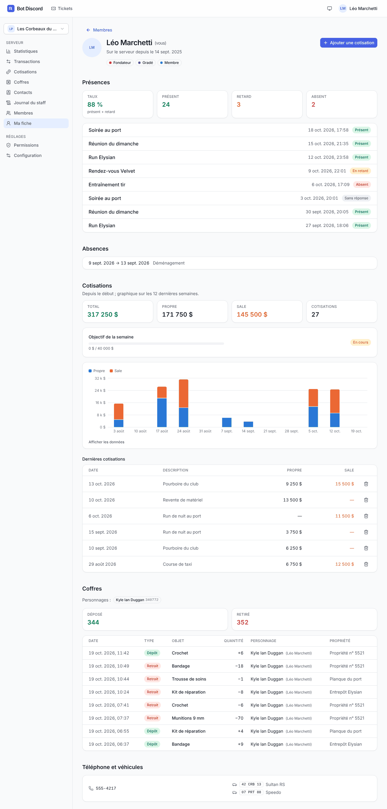

Tout un membre sur une page : rôles, présences récentes et taux, absences, cotisations (graphique et objectif de
la semaine), personnages et mouvements des coffres, semaines de recrue (avis et vétos, avec `recrue.suivi`),
numéro, véhicules. Accessible depuis la liste des membres, le classement des cotisations et le clic droit
**Fiche du membre** sur Discord.

### Permissions

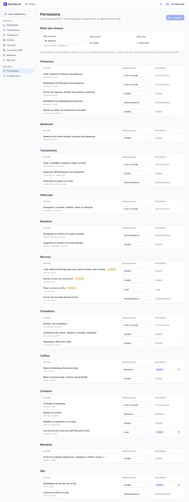

Le tableau de [`/config permission`](modules.md#permissions) : rôle des membres du groupe, puis chaque action
par module avec son niveau (liste déroulante), le niveau par défaut et les actions strictes. Seules les lignes
modifiées sont envoyées ; chaque ligne peut revenir à son niveau par défaut.

### Configuration

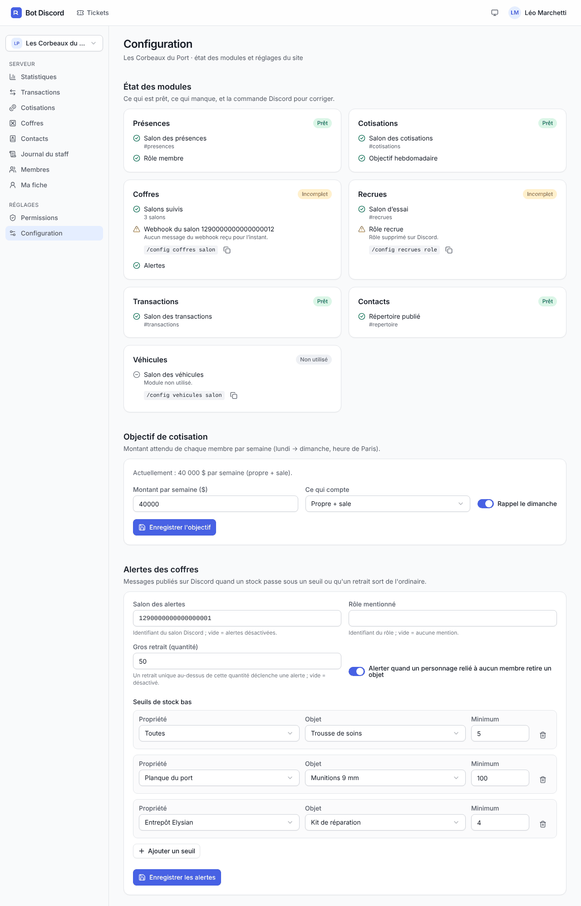

Pour chaque module : prêt, incomplet ou non utilisé, avec ce qui manque et la commande Discord qui corrige (comme
`/config etat`). Réglage de l'**objectif de cotisation** et des **alertes des coffres** (salon, rôle, gros
retrait, joueur inconnu, seuils de stock bas).

### Tickets

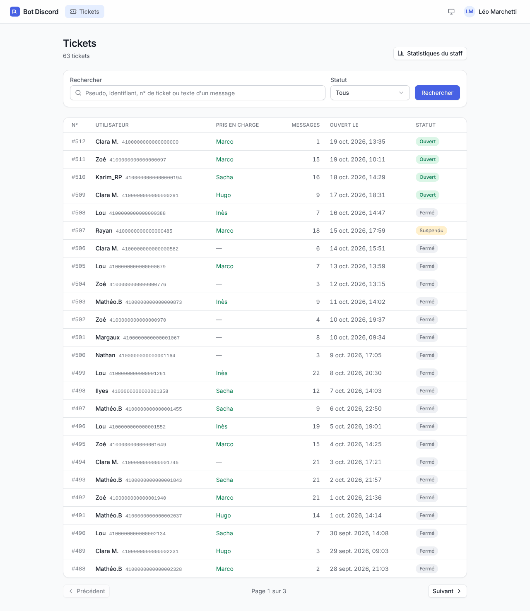

Recherche par pseudo, identifiant Discord, numéro de ticket (`42` ou `#42`) ou texte d'un message, filtre par
statut, qui a pris le ticket en charge. `/tickets/staff` : sur 30 jours, tickets ouverts, créés, fermés et sans
réponse, délai médian de première réponse, et l'activité de chaque membre du staff.

### Log d'un ticket

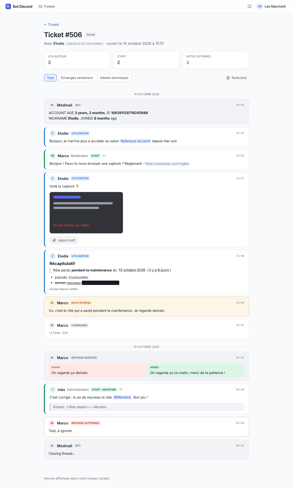 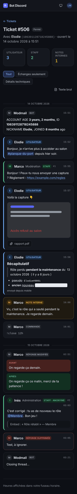

- Messages de l'utilisateur, réponses du staff (numéro, rôle affiché, anonymat), notes internes, commandes,
  réponses modifiées (avant / après) et supprimées.
- Markdown Discord complet (rendu par le bot) : spoilers, code, liens masqués, émojis, mentions avec les vrais noms.
- Images en aperçu, fichiers en lien, embeds résumés ; heures dans le fuseau du lecteur.
- Filtres **Échanges seulement** et **Détails techniques**, lien **Texte brut** (`?raw=1`, format exact de
  modmailbot, servi directement par le bot).

### API

L'interface ne lit que l'API JSON `/api/*`. Sa spécification OpenAPI 3.1 est servie sur `/api/openapi.json` et
versionnée dans `ui/openapi.json` (un test échoue si elle n'est plus à jour : `UPDATE_OPENAPI=1 cargo test
openapi_spec_is_up_to_date`). Les écritures exigent `Content-Type: application/json` et l'en-tête
`X-Requested-With: fetch` (protection contre les requêtes d'un autre site), en plus du cookie `SameSite=Lax`.

## Sécurité

- La session est un cookie signé (HMAC-SHA256, clé dérivée du token du bot), `HttpOnly`, `SameSite=Lax`,
  `Secure` en HTTPS, valable **7 jours**. Régénérer le token du bot déconnecte tout le monde.
- Les droits sont recalculés à **chaque requête** : retirer un rôle ou une permission coupe l'accès
  immédiatement, sans attendre l'expiration de la session.
- En-têtes stricts : CSP sans script externe ni script en ligne (images seulement du site et du CDN de
  Discord), pas d'intégration dans une autre page, pas d'indexation par les moteurs de recherche.

**Sans `DISCORD_CLIENT_SECRET`**, la connexion est désactivée : les logs restent lisibles par leur lien
(identifiant non devinable, comme dans modmailbot) et l'accueil indique que la connexion n'est pas
configurée. Déconseillé en production : n'importe qui ayant reçu un lien de log peut le lire.
